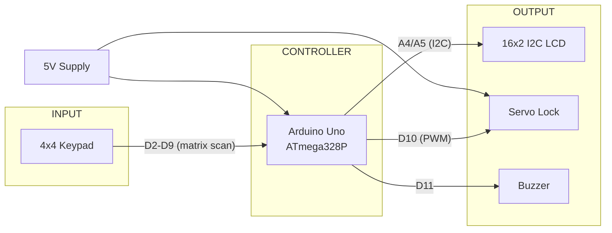
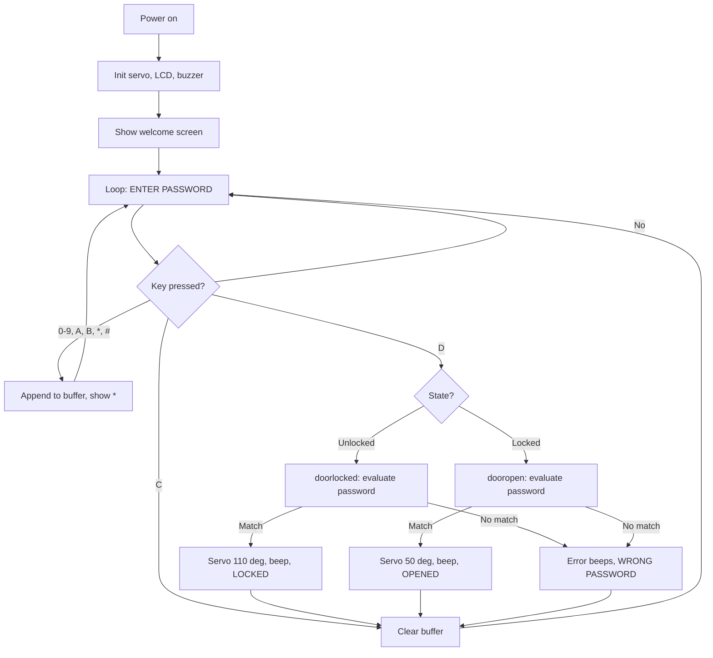

# System Architecture

## Block diagram

## Firmware flow

## Pin map

| Arduino Pin | Connected To | Function |
|-------------|--------------|----------|
| D2-D5 | Keypad rows 1-4 | Matrix scan (output) |
| D6-D9 | Keypad cols 1-4 | Matrix scan (input) |
| D10 | Servo signal | PWM position control |
| D11 | Buzzer (+) | Digital output |
| A4 (SDA) | LCD I2C SDA | I2C data |
| A5 (SCL) | LCD I2C SCL | I2C clock |
| 5V | LCD VCC, Servo VCC | Power |
| GND | All grounds | Common ground |

## Servo positions

| State | Angle |
|-------|-------|
| Open / unlocked | 50 deg |
| Locked | 110 deg |
