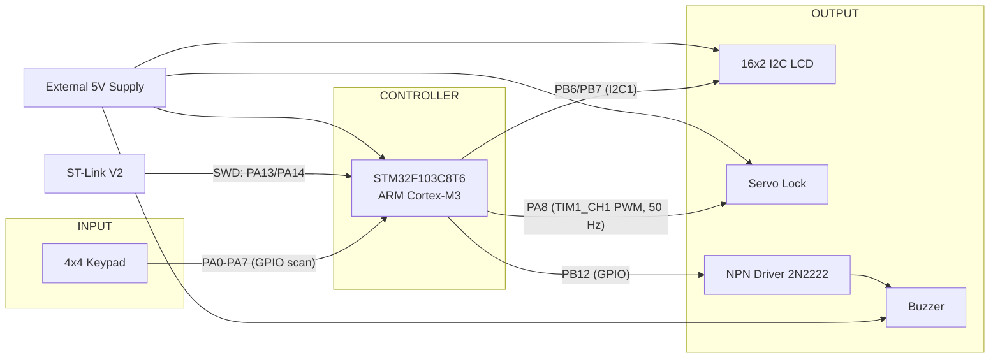
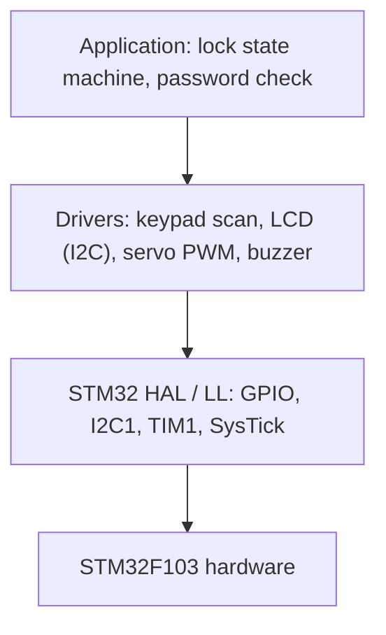

# ARM Version - System Architecture (STM32F103C8T6)

> Assumes an STM32F103C8T6 "Blue Pill" (ARM Cortex-M3, 72 MHz, 3.3V logic). If you used a different ARM board (LPC2148, STM32F4, etc.), only the pin map changes.

## Block diagram

## Firmware layers

## Pin map

| STM32 Pin | Connected To | Function |
|-----------|--------------|----------|
| PA0-PA3 | Keypad rows 1-4 | GPIO output (scan) |
| PA4-PA7 | Keypad cols 1-4 | GPIO input, internal pull-up |
| PA8 | Servo signal | TIM1_CH1 PWM (50 Hz, 1-2 ms pulse) |
| PB12 | Buzzer driver (Q1 base via 1k) | GPIO output |
| PB6 | LCD SCL | I2C1 clock |
| PB7 | LCD SDA | I2C1 data |
| PA13 / PA14 | ST-Link | SWDIO / SWCLK |
| 5V | LCD, Servo, Buzzer | Power (from external supply) |
| GND | All grounds | Common ground |

## Arduino vs ARM

| Item | Arduino Uno | STM32 Blue Pill |
|------|-------------|-----------------|
| Core | 8-bit AVR, 16 MHz | 32-bit ARM Cortex-M3, 72 MHz |
| Logic level | 5V | 3.3V (some pins 5V-tolerant) |
| Servo | `Servo` library (D10) | Hardware timer PWM (PA8) |
| I2C | A4 / A5 | PB6 / PB7 |
| Buzzer | Direct from pin | Via NPN transistor |
| Programming | USB bootloader | ST-Link (SWD) |

## Build notes
- Toolchain options: STM32CubeIDE (HAL), PlatformIO, or Arduino IDE with the STM32duino core.
- Configure I2C1 at 100 kHz and TIM1 for 50 Hz (prescaler/ARR so 1-2 ms pulses map to about 0-180 degrees).
- Keep the same servo angles as the Arduino version: 50 degrees open, 110 degrees locked (tune for your latch).
